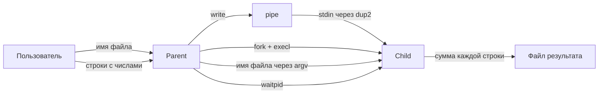

# Лабораторная работа №2

## Вариант 1

Родительский процесс создаёт дочерний процесс.

Первой строкой пользователь вводит имя файла, в который дочерний процесс будет записывать результаты вычислений.

После этого родительский процесс принимает строки вида:

```text
число число число ...
```

Все числа имеют тип `int`, количество чисел в строке может быть произвольным.

Родитель передаёт введённые строки дочернему процессу через неименованный канал `pipe`. Читающий конец канала перенаправляется в стандартный поток ввода дочернего процесса с помощью `dup2()`.

После `fork()` дочерний процесс запускает отдельную программу `child` с помощью `execl()`.

Дочерний процесс:

1. читает строки из `stdin`;
2. проверяет корректность введённых чисел;
3. вычисляет сумму всех чисел в строке;
4. записывает результат в указанный пользователем файл.

Обрабатываются ошибки системных вызовов, некорректный ввод, числа вне диапазона `int` и обрыв соединения через `pipe`.

## Взаимодействие процессов



## Структура проекта

```text
lab2/
├── report/
│   ├── report.pdf
│   └── report.tex
├── src/
│   ├── child.c
│   ├── io_utils.c
│   ├── io_utils.h
│   └── parent.c
├── CMakeLists.txt
├── README.md
└── Лабораторная работа 2.pdf
```

- `src/` — исходный код программы;
- `report/` — исходный LaTeX-файл отчёта и готовый PDF;

## Сборка

Из корня лабораторной работы:

```bash
cmake -S . -B build
cmake --build build
```

После сборки в директории `build/` будут созданы два исполняемых файла:

```text
parent
child
```

## Запуск

```bash
cd build
./parent
```

Пример ввода:

```text
Enter filename: result.txt
1 2 3
10 20 30
-5 10 15
```

Для завершения ввода необходимо нажать `Ctrl+D`.

После выполнения программы файл `result.txt` будет содержать:

```text
6
60
20
```

## Обработка ошибок

В программе предусмотрена обработка следующих ситуаций:

- ошибка создания `pipe`;
- ошибка `fork`;
- ошибка `dup2`;
- ошибка `execl`;
- ошибка открытия выходного файла;
- ошибки `read` / `write`;
- прерывание системных вызовов сигналом (`EINTR`);
- обрыв `pipe` (`EPIPE`);
- пустая входная строка;
- ввод нечисловых значений;
- выход числа за диапазон `int`;
- ошибки завершения дочернего процесса.

Родительский процесс ожидает завершения дочернего процесса с помощью `waitpid()` и анализирует его статус завершения.

## Трассировка системных вызовов

Для просмотра системных вызовов программы можно использовать `strace`:

```bash
cd build
strace -f -o trace.txt ./parent
```

Для отображения основных вызовов:

```bash
grep -E 'pipe|clone|fork|dup2|execve|write|close|wait' trace.txt
```

В трассировке можно увидеть соответствие между функциями программы и системными вызовами Linux:

```text
pipe()    -> pipe2()
fork()    -> clone()
execl()   -> execve()
waitpid() -> wait4()
```

## Отчёт

Исходный файл отчёта:

```text
report/report.tex
```

Готовый PDF:

```text
report/report.pdf
```
