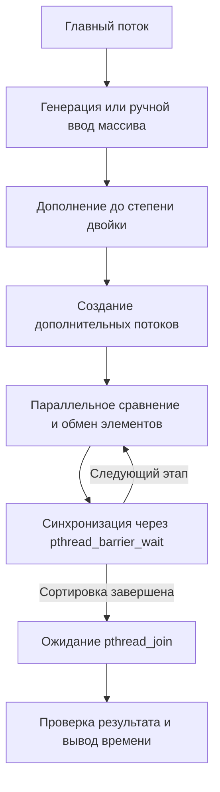

# Лабораторная работа №3

## Вариант 1

Реализовать многопоточную битоническую сортировку массива целых чисел с использованием потоков POSIX (`pthread`) в Linux.

Программа сортирует массив по возрастанию. Максимальное количество одновременно работающих потоков, включая главный, задаётся аргументом командной строки `-t`, а количество исходных элементов — `-n`.

Битоническая сортировка в этой реализации работает с массивами, размер которых является степенью двойки. Поэтому программа принимает **любое положительное количество элементов** в допустимых пределах и при необходимости дополняет массив до ближайшей степени двойки значением `INT_MAX`. После сортировки дополнительные элементы не выводятся и не учитываются при проверке исходного массива.

Поддерживаются пять режимов входных данных:

- `random` — случайные числа от 0 до 99999;
- `sorted` — числа от 0 до `n - 1` по возрастанию;
- `reverse` — числа от `n` до 1 по убыванию;
- `repeated` — случайные числа от 0 до 9 с большим количеством повторений;
- `manual` — пользователь вводит все элементы самостоятельно.

В режиме `manual` каждое значение проверяется: оно должно быть целым числом в диапазоне типа `int`. Неверные значения (например, буквы, дробные числа или переполнение) приводят к сообщению об ошибке.

Главный поток также участвует в сортировке; дополнительные потоки создаются через `pthread_create()`. Работа распределяется по независимым парам элементов. После каждого этапа сравнения потоки синхронизируются с помощью `pthread_barrier_wait()`.

Время выполнения измеряется с помощью `clock_gettime()` и часов `CLOCK_MONOTONIC`.

## Взаимодействие потоков



Все потоки обращаются к одному массиву в общей памяти процесса. Каждый поток получает свой диапазон пар сравнений, поэтому в пределах одного этапа потоки не изменяют одни и те же элементы. Барьер не позволяет начать следующий этап до завершения текущего всеми потоками.

## Структура проекта

```text
lab3/
├── report/
│   ├── screenshots/
│   │   ├── run.png
│   │   ├── threads.png
│   │   └── measurements.png
│   ├── report.pdf
│   ├── report.tex
│   └── trace.txt
├── src/
│   └── main.c
├── CMakeLists.txt
└── README.md
```

- `src/main.c` — исходный код программы;
- `report/` — исходный LaTeX-файл отчёта, PDF, скриншоты и трассировка системных вызовов.

## Сборка

Из папки `lab3`:

```bash
cmake -S . -B build
cmake --build build
```

Исполняемый файл: `build/lab3`.

## Запуск

Пример случайных данных:

```bash
./build/lab3 -t 6 -n 2000 -d random
```

Аргументы:

- `-t` — запрошенное число потоков, включая главный (положительное целое число);
- `-n` — количество исходных элементов (от 1 до `INT_MAX / 2`);
- `-d` — режим данных: `random`, `sorted`, `reverse`, `repeated` или `manual` (необязательный, по умолчанию `random`).

Внутренний размер массива `sort_n` не меньше 2 и всегда равен степени двойки. Число реально используемых потоков не превышает количества независимых пар сравнений `sort_n / 2`.

Пример вывода для 2000 элементов:

```text
Bitonic Sort
Elements: 2000
Sorting array size: 2048
Requested threads: 6
Used threads: 6
Data type: random
Sorted: yes
Time: 0.045174 s
```

Время зависит от компьютера и текущей нагрузки.

### Ручной ввод

```bash
./build/lab3 -t 4 -n 5 -d manual
```

Пример:

```text
Enter 5 integers:
7 2 9 1 4

Bitonic Sort
Input:  7 2 9 1 4
Output: 1 2 4 7 9

Elements: 5
Sorting array size: 8
Requested threads: 4
Used threads: 4
Data type: manual
Sorted: yes
Time: ... s
```

Если исходных элементов **не больше 32**, программа показывает массив до и после сортировки (`Input` и `Output`). Для больших массивов выводится только статистика, чтобы не перегружать терминал.

## Обработка ошибок

Предусмотрены проверки:

- неизвестных аргументов и отсутствующих значений после ключей;
- некорректных значений `-t` и `-n`, включая нечисловой ввод и переполнение `int`;
- неположительного числа потоков и размера массива; размер `n` дополнительно ограничен `INT_MAX / 2`;
- неизвестного режима `-d`;
- некорректных чисел при ручном вводе;
- ошибок выделения памяти;
- ошибок инициализации барьера и создания дополнительных потоков.

При обнаружении ошибки программа выводит сообщение и завершает работу. Размер массива, не являющийся степенью двойки, **не считается ошибкой**: он автоматически дополняется.

## Проверка количества потоков

В первом терминале (из папки `lab3`):

```bash
watch -n 0.2 'ps -L -C lab3 -o pid,tid,stat,comm'
```

Во втором терминале:

```bash
./build/lab3 -t 6 -n 8388608 -d random
```

Команда `ps -L` позволяет увидеть потоки процесса. При использовании шести потоков они имеют общий PID и разные TID: один поток главный и пять дополнительных. Для наблюдения сортируем большой массив без искусственных задержек.

## Трассировка системных вызовов

Чтобы сохранить полную трассировку в `report/trace.txt`:

```bash
strace -f -o report/trace.txt ./build/lab3 -t 4 -n 1024 -d random
```

Параметр `-f` позволяет отслеживать создаваемые потоки, а `-o` записывает результат в файл.

Просмотр трассировки:

```bash
less -S report/trace.txt
```

Выбор основных системных вызовов:

```bash
grep -E 'clone3?|futex|execve|write|exit' report/trace.txt
```

В трассировке можно увидеть:

- `execve()` — запуск исполняемого файла;
- `mmap()` и `mprotect()` — подготовка памяти, в том числе стеков потоков;
- `clone3()` — создание дополнительных потоков через ядро Linux;
- `futex()` — ожидание и пробуждение потоков при барьерной синхронизации, а также при ожидании завершения потока;
- `write()` — вывод результатов;
- `exit()` и `exit_group()` — завершение потоков и процесса.

Полная трассировка сохранена в `report/trace.txt`. Работа под `strace` может занимать больше времени из-за накладных расходов на отслеживание системных вызовов.

## Отчёт

Исходный файл: `report/report.tex`. Готовый PDF: `report/report.pdf`.
