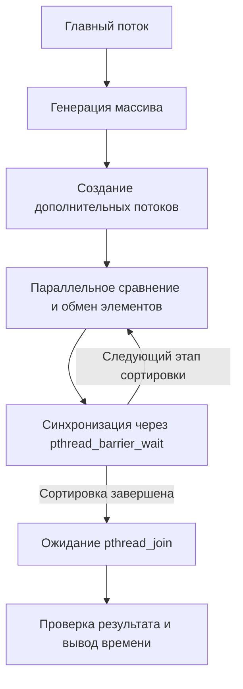

# Лабораторная работа №3

## Вариант 1

Реализовать многопоточную битоническую сортировку массива целых чисел с использованием потоков POSIX (`pthread`) в Linux.

Программа генерирует массив заданного размера и сортирует его по возрастанию. Максимальное количество одновременно работающих потоков задаётся через аргумент командной строки `-t`.

Для реализации классической битонической сортировки размер массива должен быть степенью двойки и составлять не менее двух элементов.

Программа поддерживает четыре типа входных данных:

- `random` — случайные числа от -1000 до 1000;
- `sorted` — массив, отсортированный по возрастанию;
- `reverse` — массив, отсортированный по убыванию;
- `repeated` — случайные числа от 0 до 9 с большим количеством повторений.

В сортировке участвует главный поток и дополнительные потоки, создаваемые с помощью `pthread_create()`. Работа распределяется между потоками по независимым парам элементов. После каждого этапа сравнения потоки синхронизируются через `pthread_barrier_wait()`.

Время выполнения сортировки измеряется с помощью `clock_gettime()` и часов `CLOCK_MONOTONIC`.

## Взаимодействие потоков



Все потоки работают с одним массивом в общей памяти процесса. На каждом этапе каждому потоку назначается отдельный диапазон пар сравнений, поэтому потоки не изменяют одни и те же элементы одновременно.

Барьер не позволяет ни одному потоку перейти к следующему этапу, пока остальные не завершат текущий.

## Структура проекта

```text
lab3/
├── report/
│   ├── screenshots/
│   │   ├── run.png
│   │   ├── threads.png
│   │   └── measurements.png
│   ├── report.pdf
│   ├── report.tex
│   └── trace.txt
├── src/
│   └── main.c
├── CMakeLists.txt
└── README.md
```

- `src/` — исходный код многопоточной битонической сортировки;
- `report/` — исходный LaTeX-файл отчёта, готовый PDF, скриншоты и трассировка системных вызовов.

## Сборка

Из корня лабораторной работы:

```bash
cmake -S . -B build
cmake --build build
```

После сборки в директории `build/` будет создан исполняемый файл: `lab3`

## Запуск

```bash
./build/lab3 -t 4 -n 1024 -d random
```

Аргументы командной строки:

- `-t` — максимальное количество потоков, включая главный;
- `-n` — размер массива (степень двойки, не меньше 2);
- `-d` — тип входных данных (необязательный аргумент, по умолчанию `random`).

Если запрошенное количество потоков превышает число независимых пар сравнений `n / 2`, программа автоматически уменьшает количество используемых потоков.

Пример вывода:

```text
Array size: 1024
Requested threads: 4
Used threads: 4
Data type: random
Sorted: yes
Time: 0.004915 s
```

После сортировки программа проверяет расположение элементов по возрастанию и выводит результат проверки, фактическое количество потоков и время выполнения.

## Обработка ошибок

В программе предусмотрены проверки следующих ситуаций:

- неверное количество или порядок аргументов командной строки;
- некорректное или неположительное количество потоков;
- некорректный размер массива;
- размер массива не является степенью двойки;
- неизвестный тип входных данных;
- ошибка выделения памяти;
- ошибка инициализации барьера;
- ошибка создания дополнительного потока;
- ошибка получения времени через `clock_gettime()`.

При обнаружении ошибки программа выводит соответствующее сообщение и завершает работу.

## Проверка количества потоков

Количество потоков можно проверить стандартными средствами Linux.

В первом терминале:

```bash
watch -n 0.2 'ps -L -C lab3 -o pid,tid,stat,comm'
```

Во втором терминале:

```bash
./build/lab3 -t 6 -n 8388608 -d random
```

Команда `ps -L` показывает потоки процесса. При запуске с `-t 6` отображаются шесть потоков с одинаковым PID и разными TID: один главный и пять дополнительных.

Для наблюдения используется реальная сортировка большого массива без искусственных задержек.

## Исследование производительности

Время сортировки измеряется через `clock_gettime(CLOCK_MONOTONIC)`. Генерация массива и проверка результата не включаются в измеряемое время.

Для исследования используются разные размеры массивов, типы входных данных и количество потоков.

Пример запуска для сравнения времени сортировки:

```bash
for t in 1 2 4 6; do
    echo "Threads: $t"
    ./build/lab3 -t "$t" -n 1048576 -d random
done
```

На основании полученных времён рассчитываются ускорение и эффективность многопоточной сортировки. Результаты экспериментов, таблицы и графики представлены в отчёте.

## Трассировка системных вызовов

Для получения полной трассировки системных вызовов используется `strace`:

```bash
strace -f -o report/trace.txt ./build/lab3 -t 4 -n 1024 -d random
```

Параметр `-f` позволяет отслеживать системные вызовы всех создаваемых потоков.

Просмотреть полный файл трассировки:

```bash
less -S report/trace.txt
```

Для отображения основных вызовов:

```bash
grep -E 'clone3?|futex|execve|write|exit' report/trace.txt
```

В трассировке можно увидеть:

- `execve()` — запуск программы;
- `clone3()` — создание дополнительных потоков;
- `futex()` — ожидание и пробуждение потоков при синхронизации;
- `write()` — вывод результатов;
- `exit()` и `exit_group()` — завершение потоков и процесса.

Полная трассировка сохранена в `report/trace.txt`.

## Отчёт

Исходный файл отчёта:

```text
report/report.tex
```

Готовый PDF:

```text
report/report.pdf
```
